# Review diagrams: `feat/production-ready`

**Range:** `797a495..feat/production-ready` (`797a495` is the unchanged baseline import of the app; everything below is the hardening work on top of it). Base branch for the PR: `main`.

**Goal:** make the Books app safe to ship: honest save status, tabs that don't overwrite each other, validated and migrated storage, crash recovery, backup export/import, undo, lint/tests/CI, hosting config, self-hosted fonts and Escape handling.

## Legend

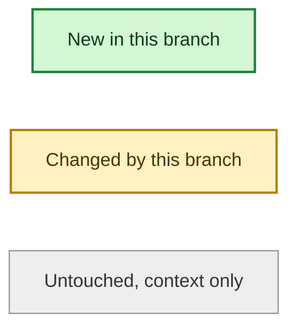

## Files changed

| Status | Files |
|---|---|
| New | `src/store/storage.js`, `src/store/merge.js`, `src/store/reducer.js`, `src/lib/backup.js`, `src/components/{BackupPanel,ErrorBoundary,StorageBanner,Toast}.jsx`, `src/styles/feedback.css`, tests (`src/App.test.jsx`, `src/store/*.test.js`, `src/lib/utils.test.js`, `src/test/setup.js`), `eslint.config.js`, `.github/workflows/ci.yml`, `.nvmrc`, `public/_redirects`, `public/_headers`, `vercel.json`, this document |
| Changed | `src/store/BooksContext.jsx`, `src/main.jsx`, `src/App.jsx`, `src/pages/{EditorPage,LibraryPage}.jsx`, `src/components/{CommentsPanel,CommentItem,BookFormDialog,Icon}.jsx`, `src/styles/{global,editor,library}.css`, `index.html`, `vite.config.js`, `package.json`, `package-lock.json`, `README.md` |
| Untouched | `src/pages/{CommentsPage,NotFoundPage}.jsx`, `src/components/{AppLayout,BookCard,ProgressBar,StatusChip}.jsx`, `src/data/*`, `src/lib/utils.js`, other styles |

## 1. Architecture

There's still no server: the app is static files, and the library lives in the browser's `localStorage`. The branch adds a storage layer between React state and `localStorage`, an error boundary around everything, and build/hosting/CI around the app. Look at where `storage` events from other tabs come in.

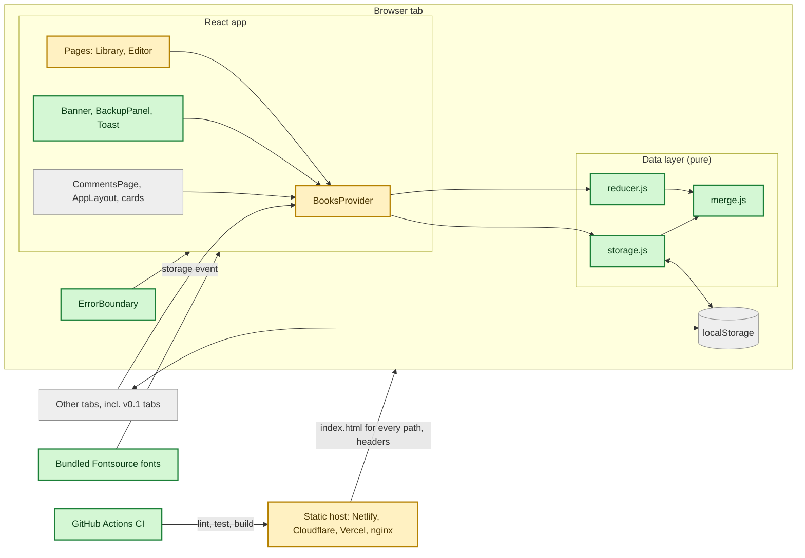

## 2. Components and dependencies

`BooksProvider` used to own the reducer and write `localStorage` itself on every change. The reducer, the load/save/validate code and the merge are now separate pure modules, with tests next to them. The UI components only talk to the provider through `useBooks()`/`useToast()`; only `ErrorBoundary` reads storage directly, on purpose, so it works when React state is broken.

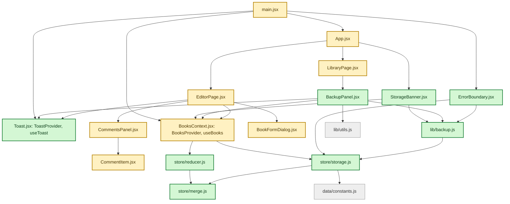

## 3. Modules and their members

These are modules, not classes, except `ErrorBoundary`. The diagram shows each one's exports and the refs and state `BooksProvider` keeps for saving and syncing. The key invariant: `base` is the books array last written, and unedited books keep their object identity, so `books === base` means "nothing to save" and the merge can use reference checks.

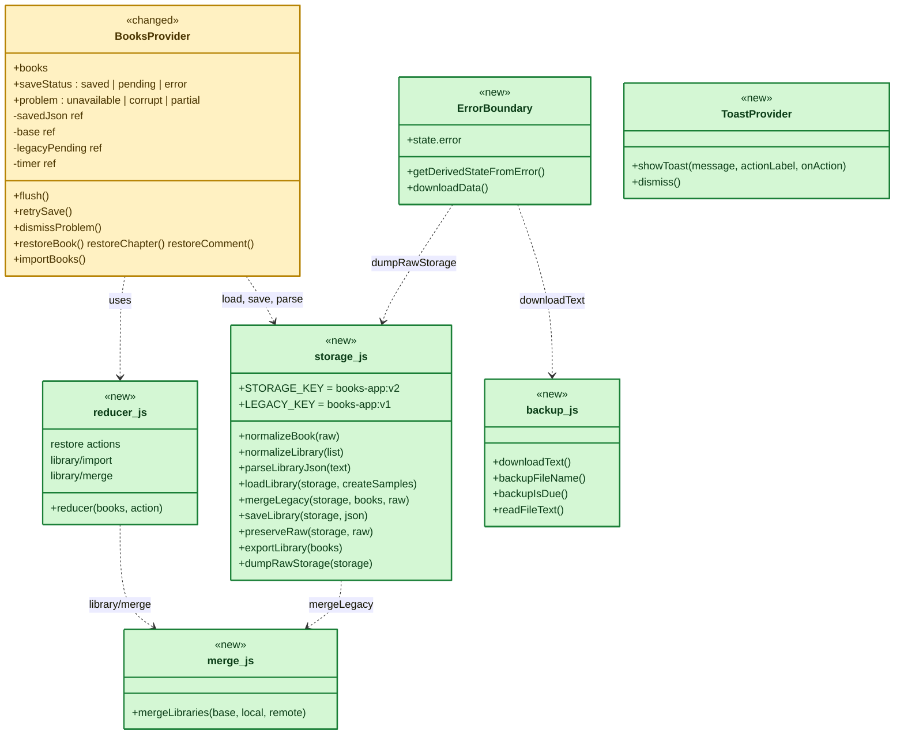

## 4. Stored data

The storage format now carries a version. v1 (a bare array under `books-app:v1`) is read and migrated. Recovery copies of anything unreadable sit under their own keys; nothing deletes them yet (see Review focus).

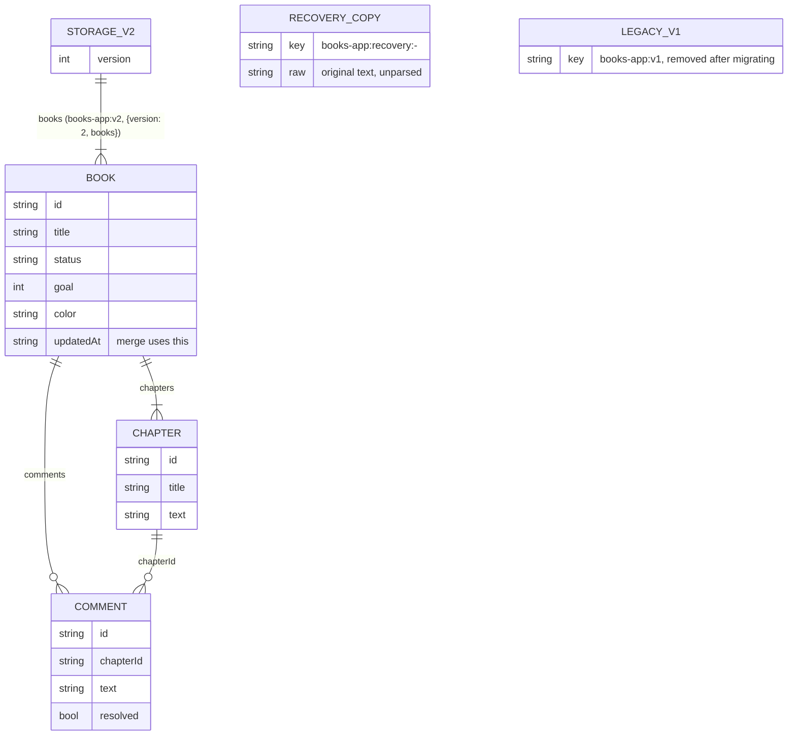

## 5. Sequences

### 5a. Typing and saving (changed)

The old code wrote the whole library on every keystroke and showed a timer-based "All changes saved" whatever happened. Now the write happens 400 ms after the last edit (or at once when the page hides), and the status shown is the result of that write.

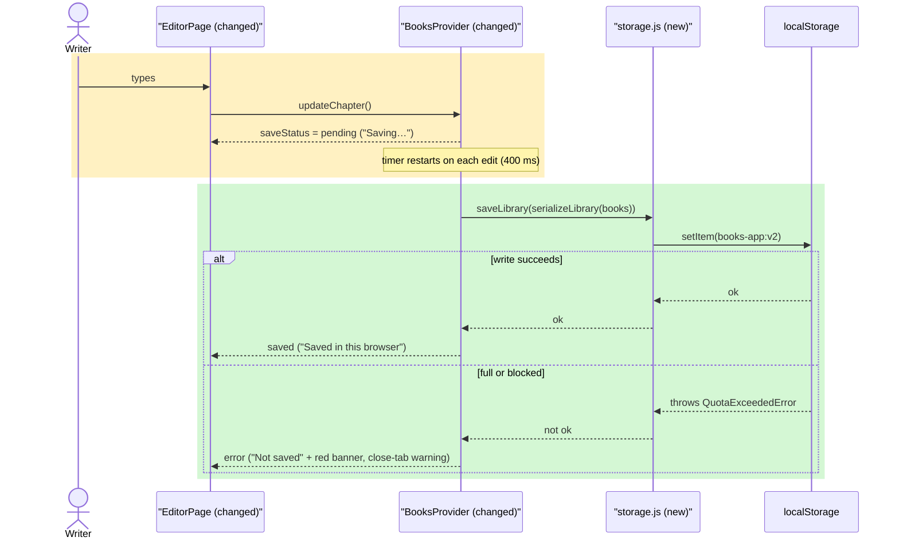

### 5b. Another tab saves (new)

Tabs used to overwrite each other's work. Now a `storage` event makes this tab merge the other tab's library book by book. A write from a tab still running v0.1 (the `books-app:v1` key) is merged with no common base: newest edit wins, nothing is dropped.

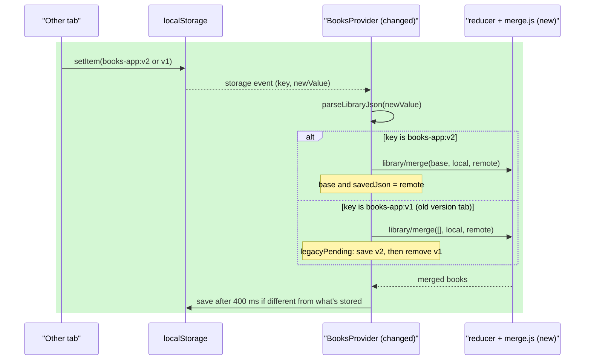

### 5c. Delete with undo (new)

Comments delete straight away; books and chapters still confirm first. Each shows a toast with Undo that puts the item back where it was.

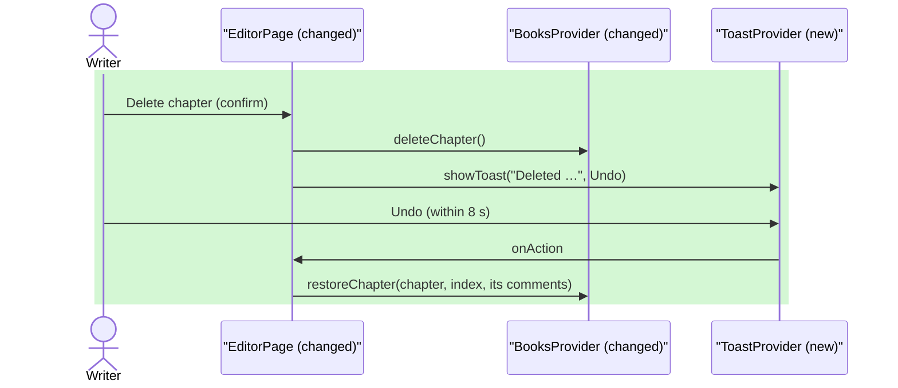

## 6. Activities

### 6a. Loading the library (new)

Before, anything that wasn't an array fell back to sample books, and a malformed book crashed the whole app to a blank page. Now each book is checked and repaired, unreadable data is kept, and a v1 key left by an old tab is merged.

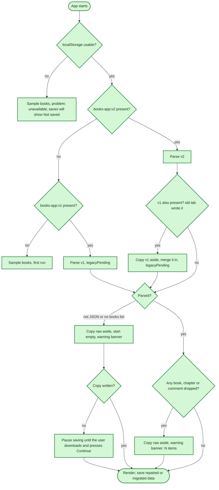

### 6b. Merging one book (new)

`mergeLibraries` runs this for every book id in base, local or remote.

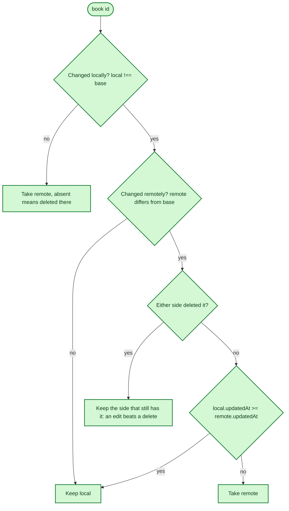

### 6c. Save status (new)

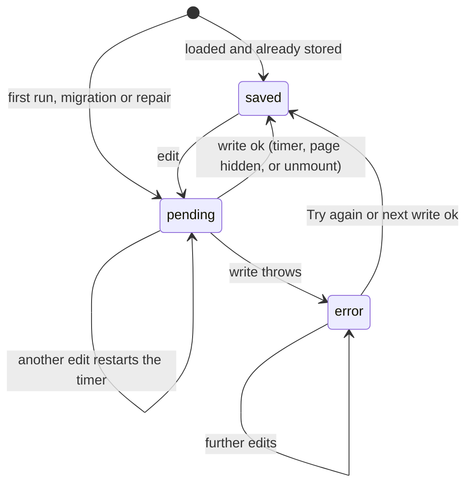

## Review focus

- **Merge tie and conflict rule.** When two tabs edit the *same* book at the same time, the newer `updatedAt` wins and the other tab's edits to that book are lost. Tabs sync within ~400 ms, so the window is small, but it's not a field-level merge.
- **v0.1 tabs** never see the new version's changes. Their writes are merged in (newest wins per book), so a stale old tab editing a book the new version also edited can override it. Reloading the old tab fixes it.
- **Recovery copies are never pruned.** Each load that finds damaged data, or a v1 key rewritten by an old tab, adds a full copy under `books-app:recovery:*`. In dev StrictMode, `loadLibrary` runs twice and makes two copies. After the banner is dismissed, these copies can only be downloaded from the crash screen.
- **Hosting headers** were written for Netlify/Cloudflare (`public/_headers`) and Vercel (`vercel.json`) but not tested on a real host. The CSP allows `'unsafe-inline'` styles because React sets inline `style` attributes.
- **Node versions:** the app builds on Node 20.19, but the test tools (Vitest 5, jsdom 31) need Node 22.22+. CI pins Node 22 via `.nvmrc`.
- **Verified:** lint clean, 67 tests passing (deliberately breaking six of the fixes each made a test fail), production build, and a manual check in Chrome: two real tabs, a forced storage failure and retry, a damaged book, and phone width at 390 px.
