# Review diagrams: `feat/user-accounts`

**Range:** `1e2b2b9..feat/user-accounts` (`1e2b2b9` is the tip of `feat/production-ready`, the base branch of this PR).

**Goal:** turn the browser-only Books app into a small client/server app: accounts with just a username and password, each writer's books stored in SQLite, everyone can read every book, only owners can edit, and the old in-browser library can be imported on first login, without giving up the earlier guarantees (honest save status, no silent data loss).

## Legend

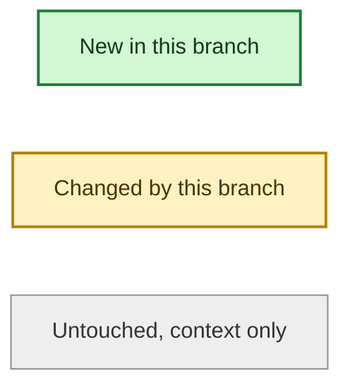

## Files changed

| Status | Files |
|---|---|
| New | `server/{index,app,db,repo,auth,validate}.js`, `server/app.test.js`, `src/lib/api.js`, `src/store/{AuthContext.jsx,sync.js,sync.test.js}`, `src/pages/{AuthPage,BrowsePage,ReaderPage}.jsx`, `src/components/ConflictNotices.jsx`, `src/styles/{auth,reader}.css`, `src/test/server.js`, `Dockerfile`, `.dockerignore`, this document |
| Changed | `src/store/{BooksContext.jsx,reducer.js,storage.js,storage.test.js}`, `src/{App,main}.jsx`, `src/App.test.jsx`, `src/pages/{LibraryPage,EditorPage,CommentsPage}.jsx`, `src/components/{AppLayout,StorageBanner,BackupPanel,BookFormDialog,CommentItem,CommentsPanel}.jsx`, `src/test/setup.js`, `vite.config.js`, `eslint.config.js`, `package.json`, `package-lock.json`, `.nvmrc`, `.gitignore`, `README.md` |
| Deleted | `public/_redirects`, `public/_headers`, `vercel.json` (static hosting can't run the API) |
| Untouched | `src/store/merge.js`, `src/components/{BookCard,Toast,ErrorBoundary,Icon,ProgressBar,StatusChip}.jsx`, `src/data/*`, `src/lib/{utils,backup}.js`, `.github/workflows/ci.yml` |

## 1. Architecture

The app is now one Node process: Express serves the API under `/api` and, in production, the built frontend. Data lives in a SQLite file. The browser keeps a per-account copy in `localStorage` as a safety net, not as the source of truth.

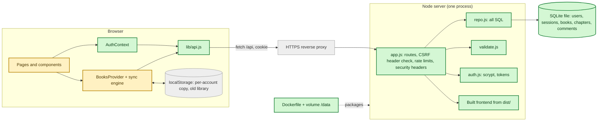

## 2. Components

Pages only talk to `useAuth()` and `useBooks()`. All network access goes through `lib/api.js`, and all SQL through `server/repo.js`. The pure modules (`sync.js`, `reducer.js`, `storage.js`, `merge.js`) carry the logic that the tests exercise most.

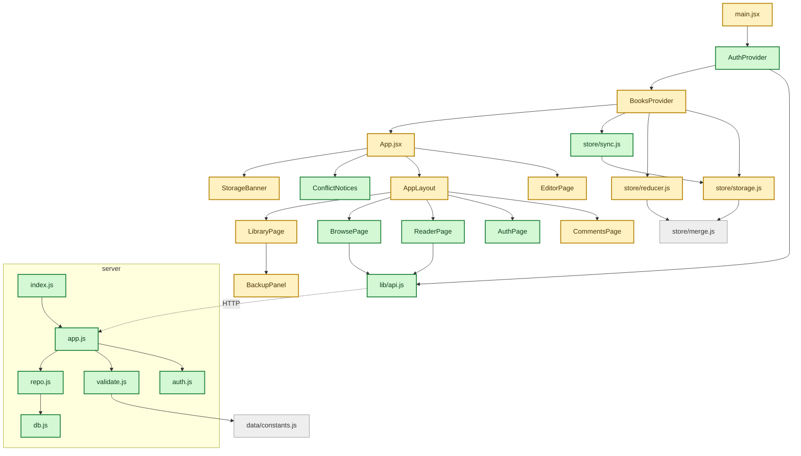

## 3. Modules

The sync state kept per account in the browser is the heart of the change: `synced[id]` (hash of the book as the server last confirmed it) and `revisions[id]` (that server revision). A book is dirty when its hash differs; an id in `synced` with no book is an unsent delete.

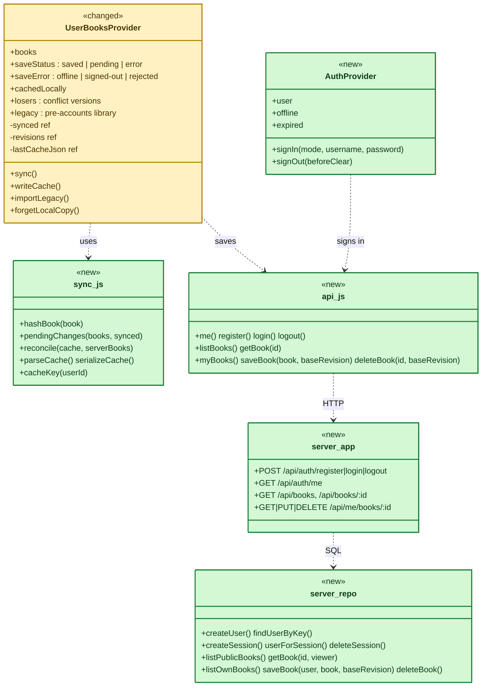

## 4. Database

Book, chapter and comment ids come from the client (UUIDs). A book id belongs to one owner: a save to someone else's id is refused with 403. `revision` is bumped on every write and is how stale saves are detected. Only a SHA-256 of each session token is stored.

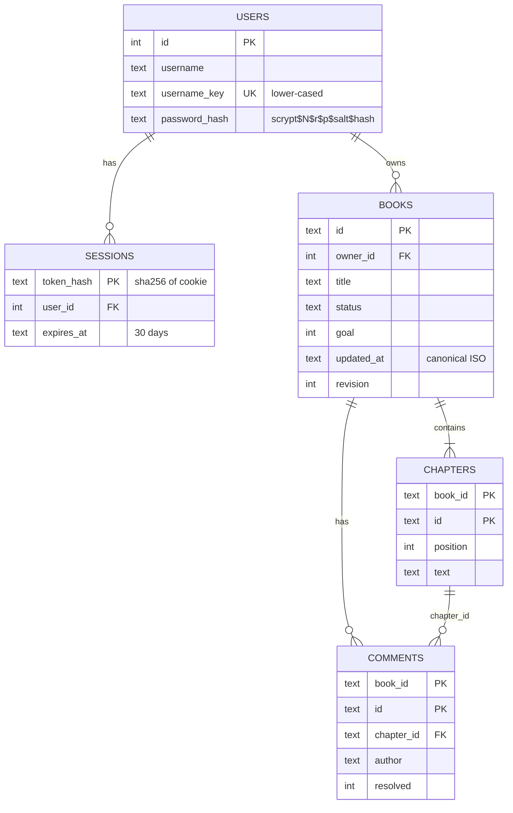

## 5. Sequences

### 5a. Registering and signing in (new)

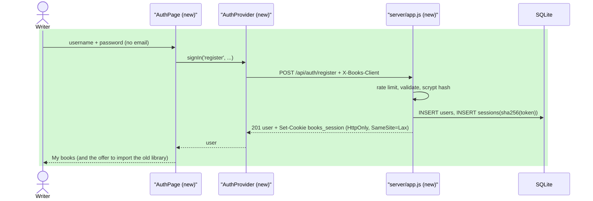

### 5b. Saving an edit (changed)

Before, the edit went to `localStorage` only. Now it goes to the per-account browser copy first and then to the server with the revision it was based on.

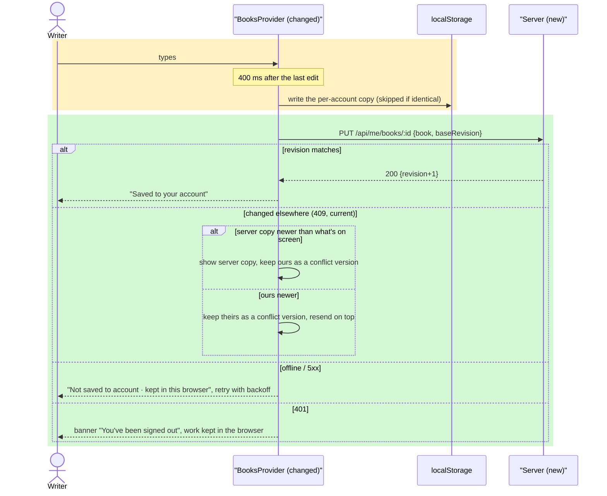

### 5c. Reading as a visitor (new)

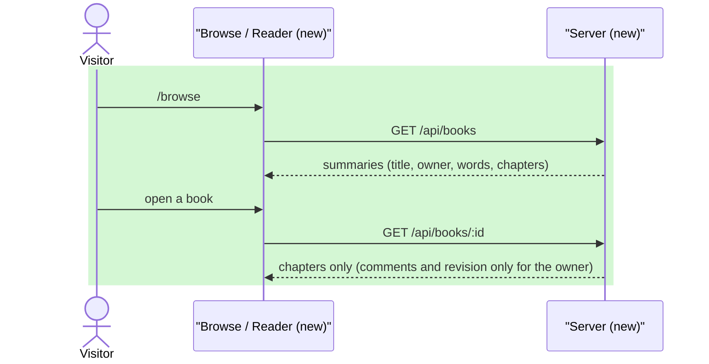

## 6. Activities

### 6a. Opening the app signed in (new): reconcile

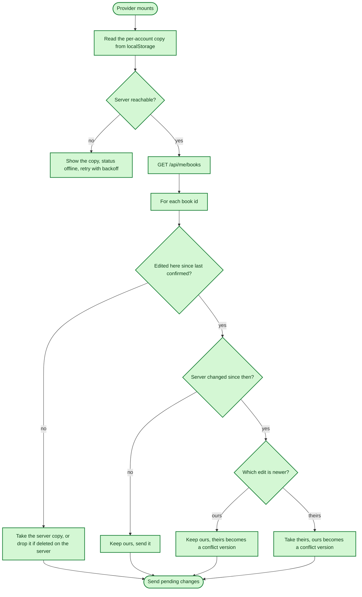

### 6b. Importing the pre-accounts library (new)

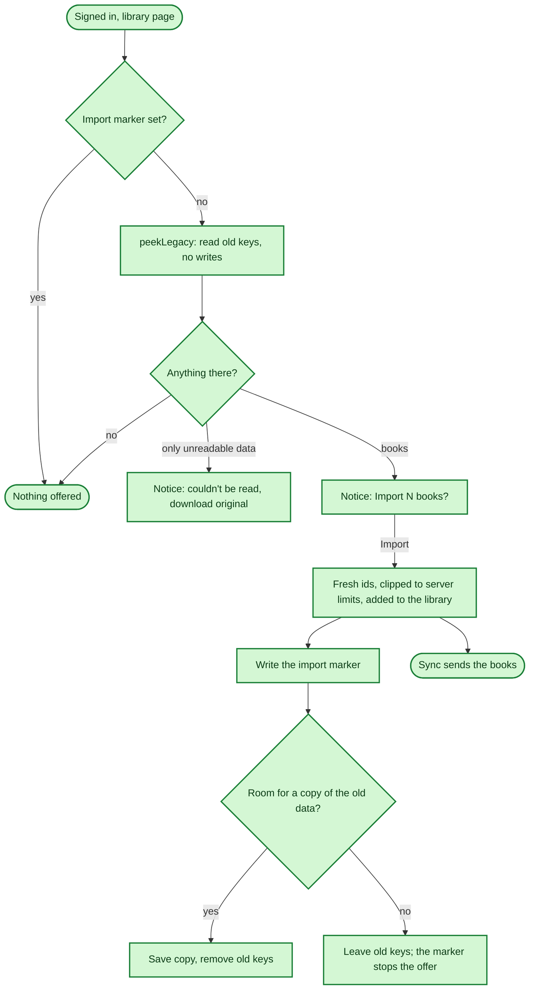

### 6c. Signing out (new)

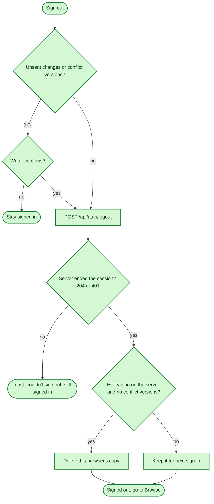

## Review focus

- **Conflict resolution is per book, newest `updatedAt` wins.** The other version is always kept for download (in the browser copy, shown on every page until dismissed), but there's no field-level merge. `updatedAt` comes from client clocks.
- **The browser copy is a safety net.** Unsent edits survive reloads and offline periods; when everything is on the server, sign-out deletes it.
- **Single process.** SQLite and the in-memory login rate limits assume one server instance; `TRUST_PROXY` must only be set when the port isn't reachable except through the proxy (README).
- **Comments are private.** Readers see chapters only; this is a product decision worth confirming.
- **Not verified:** phone layout in a real browser, the Docker build (Docker wasn't available), and the public catalogue's cost at scale (it reads all chapter text to count words).
- **Verified:** 114 tests (server through supertest; the app against the real server over HTTP), lint, build, deliberate-breakage checks of every review fix, and a manual run in Chrome (register, create, save, read signed out, cookie hidden from scripts).
